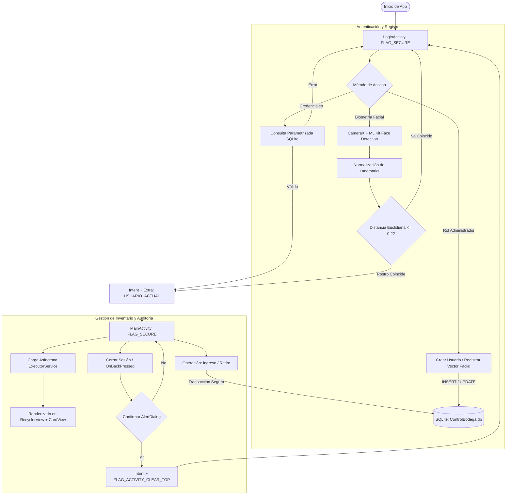
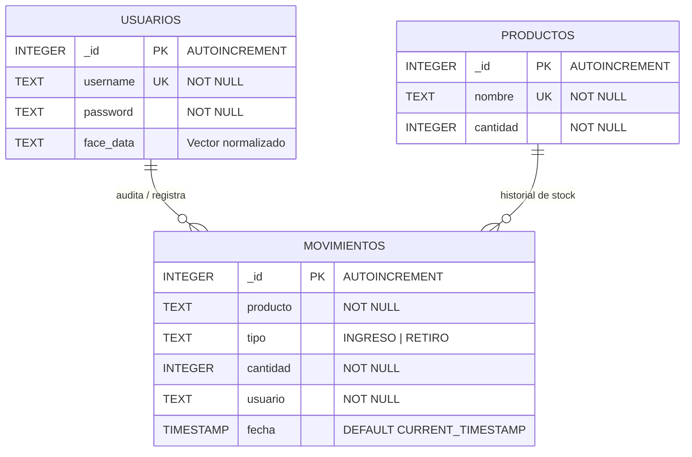

# ControlBodega - Sistema Móvil de Gestión de Inventario con Biometría Facial

Aplicación móvil nativa desarrollada en **Android (Java)** diseñada para el control, auditoría y trazabilidad de entradas y salidas de stock en tiempo real. Incorpora un motor de autenticación biométrica facial sobre el dispositivo utilizando **CameraX** y **Google ML Kit**, almacenamiento relacional local con **SQLite**, trazabilidad de acciones por operario y control de navegación seguro.

---

## Ficha del Proyecto
* **Nombre de la Aplicación:** ControlBodega
* **Desarrollador:** Alexis Gabriel Tapia Montoya
* **Asignatura:** Programación Android (IEI-093) — Evaluación Sumativa Actividad 2.5
* **Institución:** Instituto Profesional Santo Tomás
* **SDK Mínimo:** API 24 (Android 7.0 Nougat) / Target SDK 34

---

## Propósito y Características Principales

**ControlBodega** resuelve la necesidad de controlar ingresos (`INGRESO`) y despachos (`RETIRO`) de mercadería en almacenes, asociando cada movimiento de forma inmutable al operario autenticado en turno sin depender de conexión a internet ni servidores externos.

* **Autenticación Dual:** Acceso tradicional por credenciales (usuario/contraseña) y acceso biométrico mediante reconocimiento facial nativo en tiempo real.
* **Biometría Facial en el Dispositivo (On-Device):** Extracción de descriptores y puntos clave faciales (*landmarks*) mediante Google ML Kit y comparación basada en **distancia euclidiana**.
* **Gestión de Stock en Tiempo Real:** Registro de altas, bajas y actualización automática de existencias mediante tarjetas dinámicas (`RecyclerView` + `CardView`) con alertas visuales de inventario insuficiente.
* **Auditoría y Trazabilidad:** Registro persistente de movimientos (`INGRESO` / `RETIRO`) asociando cantidad, marca de tiempo y el usuario en sesión responsable del cambio.
* **Seguridad Integral y Control de Sesión:** Protección contra capturas de pantalla (`FLAG_SECURE`), cierre de turno con confirmación modal (`AlertDialog`), limpieza de la pila de navegación (`Intent Flags`) e intercepción del botón/gesto Atrás del sistema (`OnBackPressedDispatcher`).

---

## Stack Tecnológico y Dependencias

* **Lenguaje:** Java 17 / Android SDK
* **Arquitectura de Persistencia:** SQLite (`SQLiteOpenHelper`, `BodegaContract`, versionado estructurado v3)
* **Visión Artificial y Cámara:**
    * `androidx.camera:camera-camera2:1.3.1` (CameraX)
    * `androidx.camera:camera-lifecycle:1.3.1`
    * `androidx.camera:camera-view:1.3.1`
    * `com.google.mlkit:face-detection:16.1.6` (Google ML Kit Face Detection)
* **Concurrencia:** `ExecutorService` y `Handler(Looper.getMainLooper())` en segundo plano para evitar bloqueos del hilo principal (prevención de errores *ANR*).
* **Diseño UI:** `ConstraintLayout`, `RecyclerView`, `CardView` y componentes Material.

---

## Diagrama de Flujo de Actividades (UI Flow & Intents)



---

## Modelo Entidad-Relación de Base de Datos (ERD)



### Detalle de Tablas (`BodegaContract` / `BodegaDbHelper`)

#### 1. Tabla `usuarios`
| Campo | Tipo | Restricción / Propósito |
| :--- | :--- | :--- |
| `_id` | `INTEGER` | Clave primaria autoincremental |
| `username` | `TEXT` | Nombre de usuario (Único, Not Null) |
| `password` | `TEXT` | Contraseña del operario (Not Null) |
| `face_data` | `TEXT` | Vector numérico normalizado de características faciales |

#### 2. Tabla `productos`
| Campo | Tipo | Restricción / Propósito |
| :--- | :--- | :--- |
| `_id` | `INTEGER` | Clave primaria autoincremental |
| `nombre` | `TEXT` | Nombre del artículo (Único, Not Null) |
| `cantidad` | `INTEGER` | Unidades disponibles en bodega (Not Null) |

#### 3. Tabla `movimientos` (Auditoría)
| Campo | Tipo | Restricción / Propósito |
| :--- | :--- | :--- |
| `_id` | `INTEGER` | Clave primaria autoincremental |
| `producto` | `TEXT` | Artículo modificado |
| `tipo` | `TEXT` | Tipo de operación (`INGRESO` o `RETIRO`) |
| `cantidad` | `INTEGER` | Unidades alteradas |
| `usuario` | `TEXT` | Operario responsable que inició turno |
| `fecha` | `TIMESTAMP` | Marca temporal automática (`CURRENT_TIMESTAMP`) |

---

## ¿Cómo Funciona el Reconocimiento Facial?

El flujo biométrico no sube imágenes a la nube ni almacena fotos directas del usuario; opera 100% de manera local:

1. **Captura y Pipeline:** `CameraX` procesa el flujo de la cámara frontal (`DEFAULT_FRONT_CAMERA`) y entrega los fotogramas al analizador (`ImageAnalysis`) en un hilo de trabajo (`cameraExecutor`).
2. **Detección de Rasgos:** ML Kit identifica la caja delimitadora (*Bounding Box*) y localiza las coordenadas de rasgos clave:
    * Ojo izquierdo y derecho (`FaceLandmark.LEFT_EYE`, `RIGHT_EYE`)
    * Base de la nariz (`FaceLandmark.NOSE_BASE`)
    * Centro inferior de la boca (`FaceLandmark.MOUTH_BOTTOM`)
3. **Normalización del Vector:** Se calculan las posiciones relativas divididas entre el ancho y alto del rostro detectado para generar un descriptor invariante a la distancia de la cámara.
4. **Registro vs. Identificación:**
    * **Modo Registro (Admin):** El vector se serializa a texto y se actualiza en el campo `face_data` del usuario.
    * **Modo Login:** Se calcula la **distancia euclidiana** entre el vector actual y todos los usuarios registrados con rostro:
      $$\text{Distancia} = \sqrt{\sum_{i=1}^{n} (v_{\text{actual}}[i] - v_{\text{guardado}}[i])^2}$$
      Si la menor distancia se encuentra dentro del umbral de tolerancia (`<= 0.22`), el sistema valida la identidad del operario y abre su turno. Si no hay rostros registrados o la distancia excede el margen, el acceso es denegado.

---

## Auditoría de Seguridad Implementada

| Componente | Riesgo Mitigado | Implementación Técnica |
| :--- | :--- | :--- |
| **SQLite (`BodegaDbHelper`)** | Inyección SQL (`SQLi`) | Uso estricto de consultas parametrizadas (`?` con `selectionArgs`) y `ContentValues`. Cero concatenación de strings. |
| **Manifiesto (`AndroidManifest.xml`)** | Exposición de Componentes y Privilegios | `MainActivity` protegida con `android:exported="false"`. Principio de menor privilegio declarando únicamente `android.permission.CAMERA`. |
| **Pantallas Sensibles** | Capturas de pantalla y espionaje en multitarea | Implementación de `WindowManager.LayoutParams.FLAG_SECURE` en `LoginActivity` y `MainActivity`. |
| **Cámara y Archivos** | `FileUriExposedException` (`file://`) | Procesamiento de fotogramas directamente en memoria mediante `CameraX ImageAnalysis` y ML Kit, eliminando la necesidad de exponer rutas de archivos externos. |
| **Ciclo de Vida y Sesión** | Acceso no autorizado tras cierre de sesión | Limpieza de pila de actividades mediante `FLAG_ACTIVITY_CLEAR_TOP` y `FLAG_ACTIVITY_CLEAR_TASK`, e interceptación de botón atrás con `OnBackPressedDispatcher`. |

---

## Guía de Instalación y Ejecución

1. Clonar el repositorio:
   ```bash
   git clone [https://github.com/alexis-tapia-montoya/ControlBodega.git](https://github.com/alexis-tapia-montoya/ControlBodega.git)
   ```
2. Abrir el proyecto en **Android Studio** (Ladybug o superior).
3. Sincronizar dependencias de Gradle (**File -> Sync Project with Gradle Files**).
4. Ejecutar en un dispositivo físico Android (API 24+) con cámara frontal operativa y conceder el permiso de cámara al iniciar.

---

## Guía de Uso de la Aplicación

### 1. Primer Inicio y Registro de Operarios (Solo Admin)
1. Inicie la aplicación (usuarios por defecto: `admin` / `admin123` y `operario1` / `1234`).
2. En la sección **Gestión de Operarios (Solo Admin)**:
    * Ingrese el **Usuario** y **Contraseña** a crear.
    * Ingrese la clave maestra de administrador (`admin123`).
    * Presione **Registrar Usuario**.
3. Para asociar el rostro:
    * Mantenga el nombre de usuario y la clave de administrador ingresados.
    * Presione **2. Escanear y Asociar Rostro**.
    * Conceda los permisos de cámara y encuadre el rostro de frente hasta ver la confirmación en pantalla.

### 2. Inicio de Sesión
* **Método 1 (Biometría):** Presione **Ingresar con Reconocimiento Facial** y mire a la cámara frontal. El sistema identificará al operario automáticamente y cargará su sesión.
* **Método 2 (Credenciales):** Ingrese usuario y contraseña manuales y presione **Iniciar Sesión**.

### 3. Operación de Bodega
* **Ingresar Stock:** Escriba el producto, la cantidad y presione **Ingresar (+)**. Si el producto no existía, se crea automáticamente; si ya existía, suma existencias.
* **Retirar Stock:** Toque una tarjeta de producto de la lista (se autorrellenará en el formulario), escriba la cantidad a despachar y presione **Retirar (-)**. Si no hay suficiente stock, el sistema alertará del error.
* **Lista en Vivo (`RecyclerView` + `CardView`):** Cada tarjeta detalla el producto, el stock actual, el último movimiento registrado (`+X` en verde o `-X` en rojo) y el usuario responsable.

### 4. Cierre de Turno
* Al presionar **Cerrar Sesión** o presionar la flecha/gesto **Atrás** del teléfono, se despliega un diálogo de confirmación. Al aceptar, se destruye la sesión y se limpian las banderas de la pila para impedir retornos no autorizados.

---

## Permisos Requeridos (`AndroidManifest.xml`)

```xml
<uses-permission android:name="android.permission.CAMERA" />
<uses-feature android:name="android.hardware.camera" android:required="false" />
```